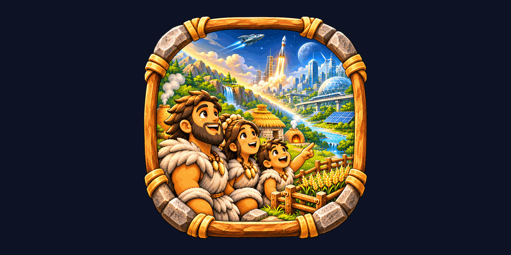
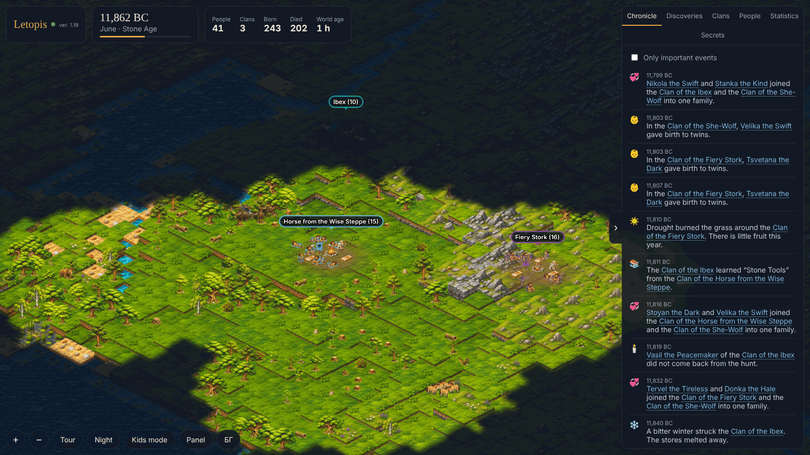

<p align="center"></p>

<h1 align="center">Letopis</h1>

<p align="center"><i>An idle civilization that lives on its own server. You just watch it grow.</i></p>

<p align="center"></p>

Letopis (Bulgarian for *chronicle*) is a self-hosted idle simulation. A few families start in the Stone Age
and, with nobody pressing a button, discover fire, tools, farming and everything after, all the way to the stars.
Open the page whenever you like and see how far they got. The world keeps living on the server while nobody is watching.

This is [GrantM28's fork](https://github.com/GrantM28/letopis) of [leppermesiah/letopis](https://github.com/leppermesiah/letopis).
It adds the ages after the Bronze Age, more world events, a statistics dashboard, notifications, a few ways to lend the world a hand,
and a reworked, English-only interface. Upstream changes are merged in from time to time.

## Features

- A generated world with relief, rivers, forests, mountains, seasons and snow, drawn in a cozy isometric pixel-art style.
- Every person has a name, parents, children and traits (strength, wit, curiosity, sociability, health, longevity) that are inherited with small mutations.
- Clans wander, split, meet, learn from each other, settle into villages and sometimes die out together with their knowledge.
- Trees grow and get cut for fires and huts; a clan moves on when the wood around its camp is gone.
- **Nine ages and 185 discoveries**: Stone, New Stone and Bronze Age, then the Iron Age, Middle Ages, Early Modern, Industrial,
  Information and Space Age. Each age opens with one discovery (iron, the watermill, the printing press, the steam engine,
  the computer, a Moon base), and every age has its smaller ones too: the bone needle and flute, irrigation, brewing and
  standing stones, mathematics and astronomy, the arch, concrete and theatre, hospitals and eyeglasses, the scientific method,
  canned food, refrigeration and the tractor, the transistor and satellites, the space elevator and terraforming, and many
  more small steps between them (ochre paint and shell beads, salt and beekeeping, canals and sundials, steel and lighthouses,
  the spinning wheel and quarantine, calculus and the hot-air balloon, cinema and X-rays, lasers and wind farms, tower farms and star probes). Discoveries change
  the world: better tools and farming, medicine, hospitals and gene medicines against disease, food that keeps, bigger castle towns,
  railways that bring clans together, universities and printing that speed up new ideas.
- **Later-age buildings on the map**: villages that know them show standing stones, a forge, castle, mills, a lighthouse, a ship,
  an observatory, a factory, a train, radio masts, office blocks, a cooling tower, solar panels, wind turbines, rockets, a dome on
  the Moon, a tower farm, the space elevator and more.
- **World events**: floods, plagues (milder with medicine), rich harvests, comets, eclipses, earthquakes, town fires, festivals,
  great buildings of each age and expeditions, alongside great hunts, hard winters and droughts.
- **Friends and rivals**: neighbouring clans warm or cool towards each other. Clans that split from one another, trade or
  write tend to become allies who send food in a bad year and grow richer from trade; hungry clans crowding the same land
  become rivals who quarrel over hunting grounds (nothing violent on screen). Alliances, rivalries and reconciliations go in the chronicle.
- **Time controls** next to the year: pause, normal speed, and fast forward (2×, 5×, 20×, 100×; each click goes faster).
  Space pauses and resumes. The speed is the world's own: it holds for everyone watching and is kept across restarts.
- **Clans that learn** (machine learning inside the simulation, nothing leaves your server): every clan carries a small
  neural network, its brain (11 senses → 8 neurons → 9 outputs, 177 weights). Each month it senses the season, hunger, food stores,
  the fruit, game and fish around, the cold, the clan's size, whether it is settled and the age of the world, and decides how the clan
  shares its work between farming, herding, fishing, crafting, building and foraging, how generous it is with its friends, and
  (for wanderers) whether to move on to fresh land before it must.
  - *Learning in a lifetime*: every two years the clan judges a slightly changed network and keeps it only if the clan ate better and
    grew, counting the people who left to found daughter clans as success (an evolution strategy, a gradient-free kind of
    reinforcement learning). Each clan tunes its own daring: bigger changes while its tries succeed, smaller while they fail.
  - *Learning from others*: now and then a clan tries a blend of a neighbour's brain that does clearly better, and keeps it only if it works.
  - *Learning over generations*: daughter clans inherit their parents' network with small mutations, and clans whose network fails go
    hungry and die out (neuroevolution).
  - It is tested: the same worlds with learning switched off grow about 15% fewer people. An early version also let brains choose
    between hunting and gathering, but every clan learned to over-hunt and the game ran out for all (a tragedy of the commons),
    so that decision was taken back. Brains also found that herding and fishing had no limit and grew villages of 30,000; a pasture
    and a river now feed only so many.
  Each clan card draws its network (green connections add, red hold back, the circles light up with what it senses now) and shows
  what it decided this month, what it reacts to most, and how much it learned from neighbours; the dashboard shows the learning
  curve and the ways of life that emerged.
- **Help the world** (the Help button, or the buttons on a clan's card to help that clan): send a blessing (food), rain,
  call a feast, inspire an inventor (four times the chance of a discovery for two years) or calm a feud. Each power has a
  waiting time shared by everyone watching, and everything is written in the chronicle.
- **Prayers**: clans in trouble pray: a hungry clan for food, a dry one for rain, a feuding one for peace. Answer them from
  the Help panel (the red number on the Help button counts them); a prayer nobody answers fades after two hours.
- **Discoveries tab**: search, filters (discovered, within reach now, not yet) and a card for every discovery: what it needs
  (and from the land), what it leads to, who found it first and when, and how many clans know it now.
- A living chronicle with filters (important, discoveries, life, clans, nature), clickable people and clans,
  family trees back to the first humans, and every discovery grouped by age with progress bars.
- **Statistics dashboard**: population and clans over time with the ages marked, births and deaths per year, discoveries over time,
  the age make-up of the living, records (most people, largest clan, oldest person), how people died, what happened most, and the timeline of the ages.
- **People tab**: everyone alive, searchable and sortable (oldest, youngest, name, most deeds, most children), plus the notable ones.
- **Clans tab**: search, sort by size, knowledge or name, with each clan's chief and size. A clan's card shows its age,
  children, elders and food, its friends and rivals, what its people are doing, what it knows and everyone in it.
- **World map** in the corner: the explored land, every clan, and the part you are looking at. Click or drag on it to go there;
  the map button in the toolbar hides it.
- The top bar shows how far the world is through the discoveries of its age and which age comes next.
- **Notifications** to your phone (ntfy) or Home Assistant (webhook) when a new age begins or a great first discovery is made.
- Kids mode with bigger letters and simpler explanations.
- "While you were away": the highlights since your last visit.
- Tour mode: the camera wanders the world by itself and stops where something happens. Nice on a TV.
- 100 tiny secrets hidden around every world.

## Pace

About three months of real time take the world from the Stone Age to the present day; after that it keeps going at the same pace.
The Stone Age is the fastest (a year in about 3 minutes), the modern centuries the slowest (a year in about 1.5 hours).
Each discovery has a target date, and its chance rises or falls when the world runs ahead of or behind history.

## Running it

### Docker

```sh
docker run -d --name letopis -p 2222:2222 -v /path/to/letopis-data:/data --restart unless-stopped ghcr.io/grantm28/letopis:latest
```

Then open `http://<host>:2222/`.

### Unraid

In the **Docker** tab choose **Add Container** and fill in:

- Repository: `ghcr.io/grantm28/letopis:latest`
- Port: `2222` → `2222`
- Path: `/data` → `/mnt/user/appdata/letopis`
- WebUI (optional): `http://[IP]:[PORT:2222]/`

To update, use **Force update** on the container. The world is saved every 2 minutes and when the container stops,
and continues where it left off after a restart. If humanity dies out, the world is archived in `/data/archive/`
and a new one begins a minute later.

### Settings (environment)

| Variable | Default | Meaning |
|---|---|---|
| `LETOPIS_PORT` | `2222` | web port |
| `LETOPIS_DATA` | `/data` | where the world, the chronicle (SQLite) and the archive live |
| `LETOPIS_SPEED` | `1` | time multiplier, only for testing |
| `LETOPIS_SEED` | random | seed of the first world |
| `LETOPIS_NTFY_URL` | – | an [ntfy](https://ntfy.sh) topic URL (e.g. `https://ntfy.sh/my-letopis`) for phone notifications |
| `LETOPIS_WEBHOOK_URL` | – | a URL that gets a JSON `POST` for each great moment (e.g. a Home Assistant webhook) |
| `LETOPIS_NOTIFY_MIN` | `3` | the least importance that is sent: 3 = new ages and first discoveries, 2 = also plagues, wonders, comets and the like |
| `TZ` | `Europe/Sofia` | time zone |

The webhook body is `{ "title", "message", "kind", "importance", "year", "world" }`. At most four notifications go out per minute.

## Building from source

Requires Node.js 22.

```sh
npm ci
npm run dev     # runs at x200 speed with data in ./data, http://localhost:2222 (macOS/Linux shell syntax)
npm run build   # production build into dist/
npm run typecheck
npm run simtest -- 42 6000 500   # simulate 6000 years of world 42 without the server, printing every 500 years
npm run check:english            # fails if anything the page shows would come out in Bulgarian (also runs on every GitHub build)
```

On Windows, start the dev server from `.claude/launch.json` or set `LETOPIS_DATA=./data` and `LETOPIS_SPEED=200` yourself
before `node --disable-warning=ExperimentalWarning dist/server.js`.

Pushing to `main` builds the Docker image with GitHub Actions and publishes it as `ghcr.io/grantm28/letopis:latest`.

### Where things are

| Path | What |
|---|---|
| `src/server/sim/sim.ts` | the simulation (upstream) |
| `src/server/sim/tech.ts`, `src/shared/later_techs.ts` | the discoveries; the Iron Age and later live in `later_techs.ts` |
| `src/server/sim/events.ts`, `src/shared/event_words.ts` | the world events and the acts of the watchers |
| `src/server/sim/relations.ts` | friendship and rivalry between neighbouring clans |
| `src/server/sim/brain.ts` | the clans' brains: how they learn and pass on their way of life |
| `src/client/minimap.ts` | the world map in the corner |
| `src/server/extras.ts` | yearly history, records, people list and acts (`/api/history`, `/api/people`, `/api/acts`) |
| `src/server/notify.ts` | ntfy and webhook notifications |
| `src/client/main.ts`, `public/` | the page: panels, tabs, cards |
| `src/client/render.ts`, `src/client/landmarks.ts` | the map; later-age buildings are drawn in code in `landmarks.ts` |
| `src/client/charts.ts` | the charts of the statistics dashboard |

The fork keeps its additions in their own files where it can, so upstream updates merge with few conflicts.

### Graphics

The sprite sheets live in `art/sheets/`. Each sheet is a grid (4×4 cells for almost all of them) and every cell is
one sprite; `tools/build_atlas.py` names the cells (for example `I11` is the man, `I12` the woman on `I-people.png`).

**Changing a sheet:** replace the PNG in `art/sheets/` with one that keeps the same file name and the same grid,
with the same thing in each cell, on a transparent or solid magenta (`#FF00FF`) background. Push it (or upload it on GitHub):
the GitHub workflow cuts the sheets, packs `public/sprites/atlas*.png` again, builds the image with them and commits the
new atlas back to the repository as "Rebuild the sprite atlas". Pull afterwards to have it locally too.

**Pixel art (8-bit) sheets** are recognised by themselves: a sheet with at most 512 colours, or with `8bit` or `pixel`
in its file name. Their outlines are kept exactly (the painted sheets lose 3 px of halo), they are scaled only by whole
numbers with nearest-neighbour, and they go on their own atlas pages that the game draws without smoothing, so every
pixel stays square. Painted and pixel sheets can be mixed while you redraw them one by one. "8-bit looking" images made
by an image generator often blend colours at the edges and have thousands of colours; put `8bit` in the file name
(for example `I-people-8bit.png`, keeping the letter prefix) to have them treated as pixel art anyway.

To do the same by hand (needs Python, Pillow and NumPy):

```sh
python3 -I tools/slice_sprites.py   # cuts the sheets into single sprites in art/cut/ (pixel.json lists the pixel-art cells)
python3 -I tools/build_atlas.py     # builds public/sprites/atlas*.png and atlas.json
```

The finished atlas is in git, so Python is not needed to build the game.

## API

`/api/health`, `/api/world`, `/api/snapshot`, `/api/chronicle?before=&after=&min=&limit=`, `/api/since?after=`,
`/api/person/:id`, `/api/tree/:id`, `/api/band/:id`, `/api/heroes`, `/api/discoveries`, `/api/stats`, `/api/worlds`, WebSocket `/ws`.

Added in this fork: `/api/history` (yearly series, causes of death, event counts, records, the ages),
`/api/people?q=&band=&sort=old|young|name|deeds|children&offset=&limit=` (everyone alive), `/api/relations/:bandId` (a clan's friends and rivals),
`/api/acts` (powers and open prayers), `POST /api/act/bless|rain|feast|inspire|calm?band=`, `POST /api/prayer/:id` (answer a prayer),
`/api/brains` and `/api/brain/:bandId` (what the clans learned, with the network itself), `/api/techtree` (every discovery, what it needs, who found it), `GET/POST /api/time?scale=0|1|2|5|20|100` (pause and speed).

`/api/health` works well as a sensor for Home Assistant or any uptime monitor.

## Roadmap

- Sprite-sheet art for the later ages, to replace the code-drawn buildings.
- States: allied towns joining into one realm, with trade roads drawn on the map.
- A longer test of the pacing of the later ages.

## Credits

Everything taken from outside, with its author and license, is listed in [CREDITS.md](CREDITS.md).
The game was created by [leppermesiah](https://github.com/leppermesiah/letopis).

## License

[MIT](LICENSE). The third-party libraries keep their own licenses, listed in [CREDITS.md](CREDITS.md).
